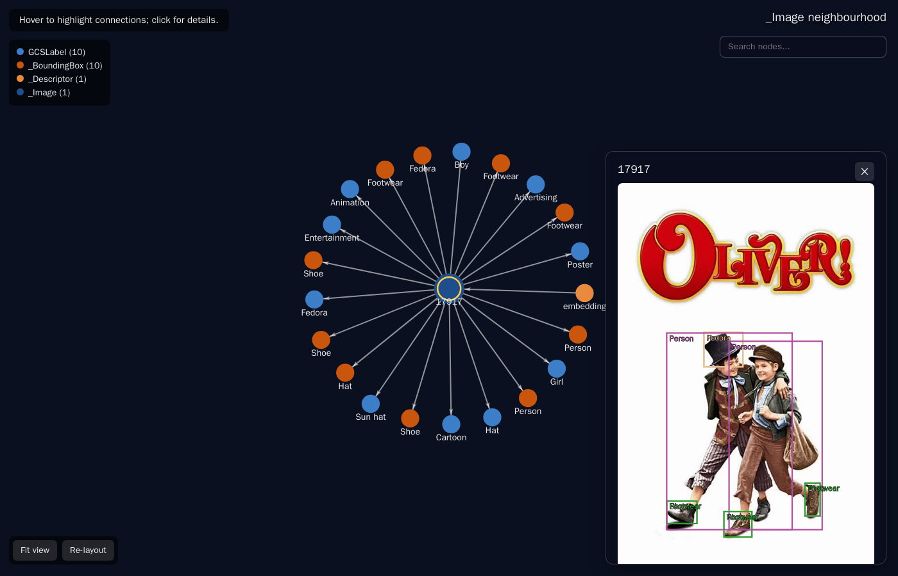
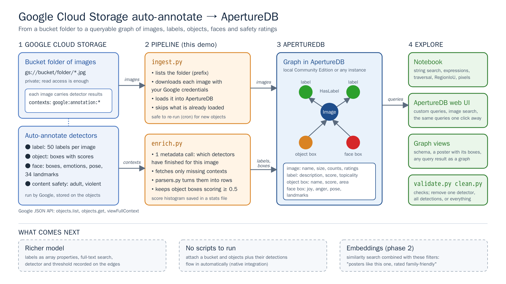
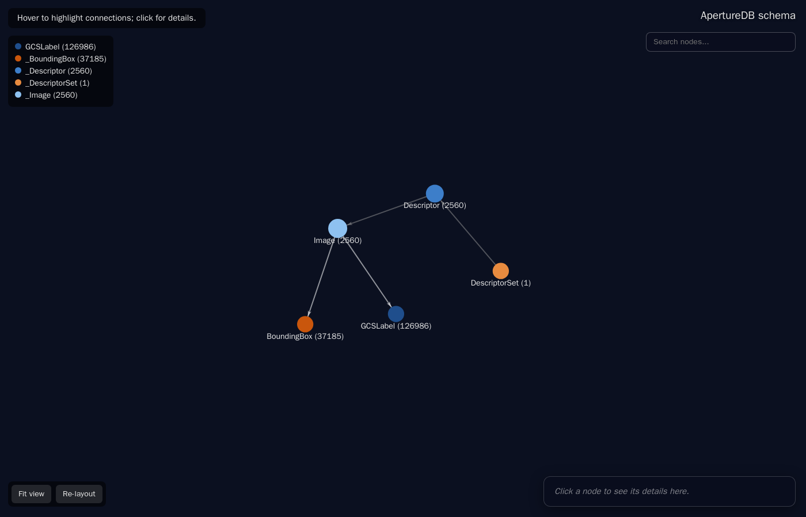

# Google Cloud Storage object enrichments in ApertureDB

Google Cloud Storage **object enrichments** run detectors on the images in a bucket (faces, objects, labels,
content safety) and store the results on each object. (Google's documentation may also call this feature
*auto-annotate*.) This demo copies a bucket folder **and** those detections into ApertureDB and shows what you can
ask once they are a graph: string search, comparisons between properties, multi-hop traversal, overlap between
boxes from different detectors, similarity search restricted by the detections, and pictures straight from the
query result.



> **Structured metadata first, vectors on top.** The detectors return labels, boxes and ratings, not embeddings. `embed.py`
> adds a CLIP embedding per poster (optional), so the same ask can be answered by similarity alone or by similarity
> restricted with the detectors' metadata (`demo.ipynb`, `quality.ipynb`; see *Vector search and metadata together*).

## How it fits together



`ingest.py` and `enrich.py` talk to the Google JSON API (`objects.list`, `objects.get`, `viewFullContext`) and to
ApertureDB; everything on the right of the graph reads only from ApertureDB. The editable source of the diagram
is [`images/pipeline.html`](images/pipeline.html).

## Quick start

You need Python 3.10+, Docker, and read access to a bucket that has object enrichment results.

```bash
./setup.sh                      # python environment + a local ApertureDB Community Edition in Docker
gcloud auth login               # or: gcloud auth application-default login
./demo.sh --bucket YOUR_BUCKET --prefix YOUR/FOLDER/ --limit 100     # a small slice first
```

Then explore: `jupyter lab demo.ipynb` (the short version) or `queries.ipynb` (the full tour), or use the notebook
container (below). Remove `--limit` for the whole folder. ApertureDB **0.19.14 or newer** is required (the compose file pins it).

## Choose your ApertureDB

The scripts talk to **any** ApertureDB; which one is decided by a key, nothing else changes.

| | How |
|---|---|
| **Local Community Edition** (default) | `docker compose up -d` (done by `./setup.sh`). Nothing to configure: `localhost:55557`, admin / admin. |
| **ApertureDB Cloud, or any other instance** | Put `APERTUREDB_KEY=...` in `.env` (see `.env.example`). Cloud: *Connect -> Generate API Key*. Local CE: `adb config get-key`. |
| **A second database** | `python ingest.py --env-file other.env ...` - every script takes `--env-file`. |

`docker compose` profiles (everything runs on ports that do not clash with a stock ApertureDB):

| Command | Starts |
|---|---|
| `docker compose up -d` | ApertureDB CE and its gateway - all the scripts need |
| `docker compose --profile notebook up -d` | + JupyterLab at http://localhost:8899 (password `test`, or set `NOTEBOOK_PASSWORD`) with this folder under `gcs-auto-annotate/` and the connection already set |
| `docker compose --profile ui up -d` | + the ApertureDB web UI at http://localhost:8088 (admin / admin). The UI image is not on public Docker Hub: you need access to it, or set `WEBUI_IMAGE`. |

The compose file pins ApertureDB **v0.19.14** (the first release with array properties and full-text search; this demo
needs it for the full-text index and the `gcs_detectors` list). Set `APERTUREDB_IMAGE` to try another server image.

The Community Edition image is licensed for evaluation and development only
([terms](https://www.aperturedata.io/docker-license)). `docker compose down` stops it, `docker compose down -v`
also deletes the data.

## Choose how data gets in

| Path | Status | What it does |
|---|---|---|
| **A. `ingest.py` + `enrich.py`** (this folder) | **Use this today** | Lists a bucket *folder*, loads the images, then pulls each object's detections. Two explicit steps; re-run them (cron) to pick up new objects. |
| **B. `aperturedata/workflows-ingest-from-bucket`** | Available | Loads the images of a whole bucket (no folder filter, needs a service-account key). Detections still need `enrich.py`. |
| **C. Native integration** | Planned | Point ApertureDB at a bucket; a background process loads new objects *and* their detections. Nothing to run by hand. |
| **D. A GCP-aware workflow** | Planned | An updated `workflows` app that takes an object and all its detections in one pass, with folder support. |

Path A exists to learn the right shape while the detectors are still changing; the parsing lives in one
file (`parsers.py`) so it can move into C or D later. See *Design choices* below.

## The scripts

All are safe to re-run, and each takes `--bucket`, `--prefix`, `--dataset-name` and `--env-file`
(defaults come from `.env`: `GCS_BUCKET`, `GCS_PREFIX`).

| Script | Does |
|---|---|
| `ingest.py` | Lists images under the prefix and loads the ones not stored yet (`--limit N` for a trial). Pictures are downloaded with your Google credentials; the database never needs them. |
| `enrich.py` | One cheap metadata call per image says which detectors have finished; only those not yet stored are fetched. Writes labels, object and face boxes, content-safety values. |
| `fetch.py` | Optional. Copies the bucket folder and the detector results into a local `--cache-dir`; `ingest.py` / `enrich.py --cache-dir` then read from it instead of Google. Prints how long the Google side took, so the Google and ApertureDB times can be told apart. Without `--cache-dir` everything is live from Google. |
| `embed.py` | Optional. Adds a CLIP embedding (ViT-B/16, same vectors as the ApertureDB embeddings workflow) per poster, read from ApertureDB, for similarity search. `pip install -r requirements-embeddings.txt` first. |
| `validate.py` | Counts per detector, orphan check, and every demo query run against your data. `--gcs` also compares with the bucket. |
| `clean.py` | Removes data in stages (below). |
| `queries.py --export` | Writes every demo query to `queries/*.json`. |
| `graph_viz.py` | Interactive graphs (below). |

**Update selectively, without re-ingesting:**

```bash
python enrich.py --only object --replace --confidence-threshold 0.2   # redo one detector (store more)
python enrich.py --only face,safety                                   # add just these
python clean.py --detector face --yes                                 # drop one detector's data
python clean.py --enrichment --yes                                    # drop all detections, keep the images
python clean.py --all --yes                                           # drop the dataset
```

**Keeping up with a growing bucket:** run `ingest.py` then `enrich.py` from cron. That is a stopgap; paths C/D
make it unnecessary.

```
*/30 * * * *  cd /path/to/gcs-auto-annotate && ./.venv/bin/python ingest.py && ./.venv/bin/python enrich.py
```

## Data model

```
_Image ──HasLabel──────▶ GCSLabel           description, score, topicality, knowledge_graph_id
  ▲  └──HasDetection──▶ _BoundingBox         edge properties: detector, score, stored_from
  │   └──── _BoundingBox                    object boxes (label = object name) and face boxes (label "face")
  └──── _Descriptor ──▶ _DescriptorSet      optional: the CLIP embedding (embed.py), set gcs_clip_vitb16
```

| Stored on | Properties |
|---|---|
| `_Image` | `id`, `dataset_name`, `gcs_bucket`, `gcs_object_name`, `gcs_generation`, `width`, `height`; `adult_content_likelihood/_rank`, `violent_content_likelihood/_rank`; `face_count`, `object_count`, `label_count`, `max_face_joy`, `min_face_joy`; `gcs_detectors` (list) |
| `_Descriptor` (optional) | `image_id`, `dataset_name`; the vector itself (512 floats, cosine, HNSW) |
| object `_BoundingBox` | `object_name`, `score` (stored from 0.3), `area_fraction`, `knowledge_graph_id`, `annotation_source = gcs-object-detector` |
| face `_BoundingBox` | `joy`, `sorrow`, `anger`, `surprise`, `pan/roll/tilt_angle`, `blurred`, `under_exposed`, `headwear`, `detection_confidence`, `area_fraction`, `landmarks_json` (all 34 landmarks), `annotation_source = gcs-face-detector` |

Likelihood enums also get a numeric `_rank` (1 = very unlikely ... 5 = very likely) so "at least POSSIBLE" is a
range filter. Boxes are native ApertureDB bounding boxes, so commands such as `RegionIoU` work on them directly.
`dataset_name` (default `<bucket>/<prefix>`) keeps several folders apart in one database.

## What it shows

[`demo.ipynb`](demo.ipynb) is the short version: one ask answered by vector search alone and then with the detector metadata; [`quality.ipynb`](quality.ipynb) scores such searches against independent TMDB genres. [`queries.ipynb`](queries.ipynb) walks through these (each with a title and what it shows: what is in the data - labels and
safety ratings counted with `results.group` -, a headline question, family-friendly filters, string search including typo-tolerant
word search, expressions, graph traversal including edge properties, spatial); every query is also in [`queries/`](queries/README.md) as
JSON to paste into the web UI's query editor. With the `ui` profile running, open
http://localhost:8088/load-queries.html once and all of them appear under **Queries** in the UI's Custom Query page
(the UI keeps saved queries in the browser, so do this once per browser).

* **String search** - `icontains`, `regex`, `like`, `starts_with` over labels, object names and file names
  (trigram indexes), combined with `any` / `not` and score filters in one request.
* **Expressions** - `["$joy", ">", "$sorrow"]`, `[{"abs": "$pan_angle"}, "<", 20]`, `[{"add": ["$joy", "$surprise"]}, ">", 0.85]`:
  compare and compute on properties inside the database.
* **Graph traversal** - label -> poster -> faces in one request; posters connected to a label *and* an object.
* **Spatial** - `RegionIoU` between a person box and a face box.
* **Pixels** - the result can be the cropped faces themselves.

## Vector search and metadata together

Similarity search finds what a poster *looks like*; it cannot tell a smile from a smiley, a cartoon or a gesture, and it knows nothing
about content ratings. The detector results can. In ApertureDB the two combine in one query: the metadata filter runs *inside* the
nearest-neighbour search, so you still get `k` results, all of which satisfy the filter.

```bash
pip install -r requirements-embeddings.txt        # torch (CPU is fine) + open_clip
python embed.py --bucket YOUR_BUCKET --prefix YOUR/FOLDER/       # about a second per poster on a laptop CPU
```

* [`demo.ipynb`](demo.ipynb): one ask, "something a child could watch tonight, where everyone looks happy", answered side by side by
  vector search alone and by vector search + metadata, with the counts a viewer cares about (unhappy faces, ratings) and the
  index's recall against an exact brute-force search.
* [`quality.ipynb`](quality.ipynb): several asks, scored two ways: from the stored detector values, and against **TMDB genres**
  (public data, independent of the detectors) for the posters in the sample dataset.
* The asks used in the notebooks have their query vectors precomputed in `query_vectors.json`, so the notebooks run (for example in the notebook
  container) without torch or the CLIP model; only a new ask needs `requirements-embeddings.txt` (`python vector_search.py add "your ask"` stores it).
* The embeddings are CLIP ViT-B/16 (512 dimensions, cosine, HNSW). They are identical to what ApertureDB's embeddings workflow
  produces by default, so a set made by that workflow is interchangeable. `vector_search.py` holds the query builders.

## Graph views

`graph_viz.py` draws the database as an interactive graph (a rewrite of the helper from aperture-nexus that works
for any schema).

```bash
python graph_viz.py schema                                    # classes and connections with live counts
python graph_viz.py node _Image --where gcs_object_stem=10028 --label _Image=gcs_object_stem --open
python graph_viz.py query queries/12_happy_frontal_faces.json --label _Image=gcs_object_stem --open
```

Click a node for its properties, its picture with every stored box drawn over it, and the query that fetches it
(the × button, Esc or a click on the background closes the panel; clicking never moves the view or the layout).
The layout settles and then stays put, drag a node to move it; **Fit view** shows the whole graph and **Re-layout** lets
it move again. The legend hides a class; the search box dims what does not match. In a notebook the same functions
(`render_schema`, `render_neighborhood`, `render_query`) show inline. The page loads its graph library from a CDN,
so the browser needs internet access.



## What the detectors return

From a first sample of 20 posters: the object detector returns every proposal it considers (63 per image on
average, scores from 0.01 up); `enrich.py` stores those scoring at least **0.3** (with their score on the `HasDetection`
edge), and queries use the confident ones, **0.5** and up. Labels
come as exactly 50 per image, down to scores around 0.25. Content safety has two fields (adult, violent).
`enrich.py` writes `enrich_stats.json` with the full score histogram, including what was not stored, so you can
judge the threshold (`--confidence-threshold`, default 0.3); the notebook shows it.

## Tests

```bash
pip install -r requirements-dev.txt
python -m pytest tests          # parsing, data model, graph views; live tests run against your ApertureDB
```

Tests that need a database skip themselves if none is reachable; none of them needs Google Cloud.

## Troubleshooting

* `No Google credentials found` / `Reauthentication failed` - run `gcloud auth login` yourself in a terminal.
* `enrich.py` stores nothing - the objects have no object enrichment results yet (`validate.py --gcs` shows what GCS finished).
* Port already in use - set `APERTUREDB_PORT`, `WEBUI_PORT` or `NOTEBOOK_PORT` in the environment before `docker compose up`.
* Graph page is blank - the browser could not reach the CDN (`esm.sh`, `cdn.jsdelivr.net`).

## Design choices

| Choice | Why |
|---|---|
| Own `ingest.py` / `enrich.py` instead of the published workflow image | That image loads a whole bucket (no folder filter), and the detectors are still evolving, so a small pipeline that is easy to reshape fits better for now. The parsing is isolated in `parsers.py` and the data model in `model.py` so both can move into a workflow or a native integration later. |
| Detections come straight from the GCS API; BigQuery is not required | Fewest moving parts for someone trying the demo: bucket read access and a login. Fetching is isolated in `gcs.py`, so a BigQuery source can be added without touching parsing or the model. |
| Object proposals are stored from 0.3; queries use 0.5 | Most proposals below 0.3 are noise, but the band between 0.3 and 0.5 is worth keeping: the score sits on an explicit `HasDetection` edge, so the cut-off can move in a query without calling Google again. Both numbers are configurable, and `enrich_stats.json` keeps the full score histogram so the choice can be reviewed. |
| Labels stay one node per label (no array property) | Per-label counts (the vocabulary), shared-label traversal, label nodes in the graph views, per-label scores and substring search (`icontains`) all work on nodes; an array property would be faster to load but loses them. |
| `gcs_detectors` is a list property | The detectors stored per image, used to skip finished work on a re-run. |
| Indexes: a `type` index next to every ordered / trigram index | ApertureDB 0.19.14 only uses an ordered or trigram index together with a `type` index on the same property; `model.ensure_indexes` creates both, plus a full-text index on the label text. |
| Face landmarks as one JSON property, no polygons | A polygon is 2D with a single label, so it cannot hold landmark depth or names, and the points do not form a closed shape. Nothing here needs eye or mouth regions. |
| Likelihood enums also stored as a numeric `_rank`; counts and maxima stored on the image | "At least POSSIBLE" becomes a range filter, and "crowded posters" becomes a plain filter. |
| Idempotent writes | Image ids hash the object path; every box and label has a deterministic `det_id` and uses `if_not_found`. Re-running never duplicates, which is also how a growing bucket is followed. |
| Ingestion, enrichment and cleanup are separate, selective steps | Re-run queries or redo one detector without re-downloading images; `clean.py` removes one detector, all enrichment, or everything. |
| Native bounding boxes | `RegionIoU`, crops and the box overlays in the graph views work without custom geometry. |
| `graph_viz.py` rewritten from the aperture-nexus helper | The original issued one query per node, assumed an `id` property and `FindEntity`-style classes, and put data into the page unescaped. The new one navigates with batched, capped queries (falling back to per-node queries on servers without `group_by_source` / `per_group`), supports every native type, and knows nothing about this schema. |

## What's coming

* **Embeddings from the source:** if the enrichments ever include embeddings, they slot in next to the CLIP ones (or replace them) in the same descriptor set.
* **Native integration and a GCP-aware workflow** (paths C and D above): point ApertureDB at a bucket and have
  objects and detections loaded automatically; the cron job in this README is the stopgap they replace.
* **More detector types** such as PDF and video: new branches in `parsers.py` and `model.py`.
* **A BigQuery source** behind `gcs.py` for very large buckets.
* **Polygons for facial regions** (eyes, mouth) if a query needs them; landmarks stay available either way.
* **Edge properties** on `HasLabel` (the box edges already carry them, see `HasDetection`), enabling edge-centric queries with `FindConnection`
  and `is_endpoint_of`.
* **`graph_viz.py` as a shared tool:** it is schema-agnostic and could live in a common package.
